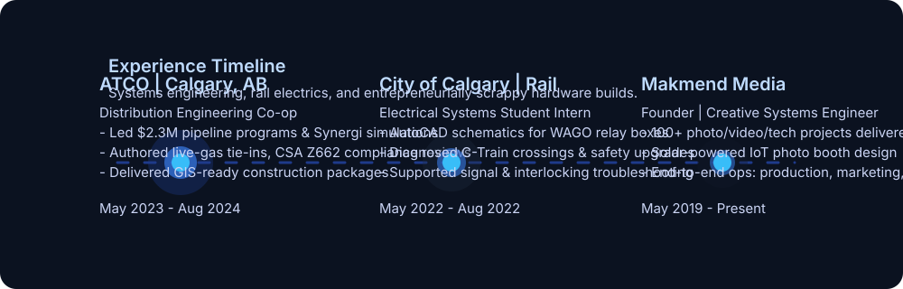

## 👋 Hey, I'm Aidan

I'm an electrical engineering student at The University of British Columbia (Kelowna) graduating in 2026. I love taking complex infrastructure problems—from distribution pipelines to rail signaling—and turning them into reliable systems with clean documentation, intuitive tooling, and a little design polish.

- 🎓 Current focus: power systems, embedded hardware, and simulation-driven design  
- 💼 Most recent role: Distribution Engineering Improvements Co-op @ ATCO (Calgary, AB)  
- 🛠️ Building: hand-wound BLDC motors, autonomous Raspberry Pi cars, and a solar-powered IoT photo booth  
- 🌐 Portfolio: [aidanmendoza.com](https://aidanmendoza.com) | 📬 [aidan.mdz.ca@gmail.com](mailto:aidan.mdz.ca@gmail.com) | 📍 Calgary, Alberta  
- 📄 [Download my resume](./AIDAN_MENDOZA.pdf)

---

## ⚙️ What I'm working on

- Finishing my BASc in Electrical Engineering at UBC with a focus on resilient energy distribution and safety-critical circuitry.
- Capturing lessons from $2.3M+ pipeline replacement programs—design reviews, Synergi hydraulic simulations, and live-gas tie-in procedures.
- Prototyping motor drivers and sensor suites for small-form factor mobility systems.
- Running Makmend Media, a creative/technical studio delivering photo, video, and custom hardware builds for 100+ clients.

---

## 📈 Experience Snapshot

### Highlights

- **ATCO | Distribution Engineering Improvements Co-op (May 2023 - Aug 2024)**  
  Managed design packages for multi-million-dollar pipeline replacements, coordinated construction, land, and environmental teams, ran Synergi hydraulic simulations, and authored live-gas tie-in procedures aligned with CSA Z662/AUC requirements.

- **City of Calgary | Electrical Rail Systems Intern (May 2022 - Aug 2022)**  
  Produced AutoCAD Electrical schematics for WAGO relay boxes, brought switch diagrams up to current safety standards, and supported signal/interlocking maintenance across the C-Train network.

- **Makmend Media | Owner/Operator (May 2019 - Present)**  
  Full-stack creative/technical studio: built a solar-powered Li-ion photo booth with IoT telemetry, delivered professional media services with advanced camera rigs, and handled operations from client acquisition to P&L.

---

## 🧪 Selected Projects

| Project | Tech | Why it matters |
| --- | --- | --- |
| **Brushless DC Motor** (Mar 2025) | LTSpice / Fusion 360 / custom stator windings | Designed and hand-assembled a 3-phase BLDC motor, tuned balance/magnet placement, and integrated RC control electronics for smooth wireless throttle. |
| **16-bit Arithmetic Logic Unit (ALU)** (Nov 2024) | SystemVerilog / EDA Playground | Implemented a multi-operation ALU with opcode decoding and a custom testbench for edge-case validation in a synthesized environment. |
| **Tractive System Active Light (TSAL)** (May 2024) | Altium / LTSpice | Engineered a safety-critical indicator per FSAE rules, combining comparator/FET logic, validated by simulation and bench testing, and integrated with vehicle interlocks. |
| **Self-Driving Pi Car** (Jan 2023) | Raspberry Pi / Python / Keras / OpenCV | Trained a CNN for lane-following, deployed real-time inference on-device, and fused OpenCV with PWM motor control for stable autonomous navigation. |

---

## 🛠️ Toolbox

| Systems & Simulation | Firmware & Software | CAD & Fabrication | Ops & Creative |
| --- | --- | --- | --- |
| Altium, LTSpice, Intel Quartus, PSIM, Bluebeam, ArcGIS, Primavera | Python, MATLAB/Simulink, SystemVerilog, ARM Assembly, C++, R/RStudio, HTML/CSS | SolidWorks, AutoCAD, Fusion 360, Inventor, Creality Print | Microsoft Office (Excel/Word/PowerPoint), Adobe Suite, WordPress |

---

## 📫 Let's connect

- Email: [aidan.mdz.ca@gmail.com](mailto:aidan.mdz.ca@gmail.com)  
- Website: [aidanmendoza.com](https://aidanmendoza.com)  
- Phone: (403) 608-1021  
- Location: Calgary, Alberta

Thanks for stopping by! If you're building resilient infrastructure, electric mobility systems, or creative human-centered tools, I'd love to collaborate.
